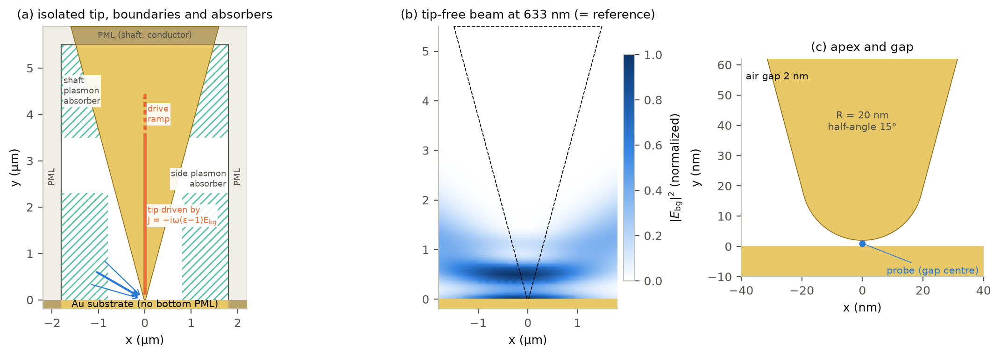

# meep-2d-ters-simulation

2D FDTD simulation of gap-mode tip-enhanced Raman spectroscopy (TERS) near fields, built on
[Meep](https://github.com/NanoComp/meep). A semi-infinite metal tip is held a few nm above a
metal or dielectric sample, optionally covered by a 2D material, and illuminated by a focused
p- or s-polarized beam; the code returns the field enhancement in the gap, near-field maps,
spectra and parameter sweeps.

It is written for people who want to run a similar TERS simulation for their own case (their
tip radius and cone angle, gap, substrate, 2D layer from their own n, k data, illumination,
wavelengths): the method (an isolated tip with absorbing boundaries, an exact focused beam at
every wavelength, a scattered-field formulation) is fixed and checked against analytic and
frequency-domain references, everything that defines your case is a small set of
dataclasses, and the docs say how to check a new case before trusting it. It runs on upstream
Meep (CPU) and unchanged on [gpmeep](https://github.com/iverydj/gpmeep-releases), a CUDA build
of Meep, for GPU speed.



*(a) Computational domain: semi-infinite gold tip, PML wherever the cell is open, lossy-air
absorbers for the surface plasmons of the shaft and the substrate, focused beam at 60°. (b) The
analytic tip-free field, which drives the tip and is the reference of the enhancement. (c) Apex
and gap.*

## Quick start (CPU Meep, ~2 minutes)

```bash
conda env create -f environment-meep.yml && conda activate ters2d-meep   # upstream Meep 1.34
pip install -e .
python examples/01_quick_low_res_single_wavelength.py
```

or, in Python:

```python
from ters2d import Model, Numerics, Sample, Tip, materials, simulate

model = Model(tip=Tip(apex_radius_nm=20, half_angle_deg=15), sample=Sample(materials.AU),
              gap_nm=2.0, numerics=Numerics.small(resolution=500))   # coarse 2 nm grid
r = simulate(model, 633.0, "runs/quick")
print(r.ef_probe)   # |E|^2 / |E_tip-free|^2 at the gap centre
```

This coarse run (0.44 million cells, 105 s on one core) in the small, cheap domain is for
learning the workflow, not for numbers; the reference set-up is `Numerics.production(1000)`
(1 nm cells, 27 million cells), and [setting up your simulation](docs/setting_up_your_simulation.md)
explains how to check convergence. The tests run without Meep:
`pip install -e ".[test]" && pytest`.

## On a GPU with gpmeep

Install gpmeep in its own environment ([installation](https://github.com/iverydj/gpmeep-releases))
and `pip install -e .` there. No code change; select the backend before Python starts:

```bash
MEEP_GPU_BACKEND=cuda CUDA_VISIBLE_DEVICES=0 python examples/02_spectrum.py
```

A production-size wavelength (27 million cells) takes ~7 min of time stepping on one RTX A6000
(FP32) against ~60 min on 32 CPU cores (FP64), with the same result to 3 × 10⁻⁶.

## Documentation

* [Model and method](docs/model.md): geometry, materials, beam synthesis, scattered-field
  formulation, boundaries and absorbers, and why.
* [Setting up your simulation](docs/setting_up_your_simulation.md): changing the tip, gap,
  substrate, 2D layer, materials (from n, k data), illumination and numerics; convergence
  checklist; run times and memory.
* [Outputs](docs/outputs.md), [validation](docs/validation.md), [results](docs/results.md),
  [limitations](docs/limitations.md), [API](docs/api.md).

Examples, simplest first: `01_quick_low_res_single_wavelength`, `02_spectrum`,
`03_gap_sweep`, `04_radius_sweep`, `05_custom_substrate_and_2d_layer`,
`06_add_material_from_nk`, `07_field_map`, `08_convergence_check`, `09_s_polarization`. Every
script has an `AppConfig` dataclass at the top instead of command-line options.

## Results


Over gold the intensity |E|² in the gap is 151 times that of the tip-free field at
633 nm, over SiO2 19 times: the gold mirror turns the apex field into a gap plasmon. A
WS2 monolayer in the 2 nm gap raises the enhancement in the remaining air gap by up to a factor
of 2; at its excitons the gain is smaller, and around the B exciton the layer lowers it. With
s polarization (E along the 2D tip) there is no gap mode: over gold at 633 nm the gap intensity
is 4.7 × 10⁴ times lower than with p. Spectra, near-field maps, gap and radius dependence, the
WS2 and the s-polarization results are in [docs/results.md](docs/results.md), with every table
behind the figures in `docs/figures/data/`.

## Repository layout

```
src/ters2d/   model (dataclasses), materials, fitting, layout, background (analytic beam
              and layered sample), sources, meep_model, run, results, fem, analysis, plotting
examples/     templates, simplest first
reproduce/    scripts for the results and the figures
validation/   checks against analytic, FEM and FP64 references
materials/    n, k data (CC0) and the WS2 fit
docs/         documentation, figures and their data
tests/        pytest suite (Meep-dependent tests are skipped without Meep)
```

## Citation and data sources

Please cite this software with [CITATION.cff](CITATION.cff). Data and methods used:

* Meep: A. F. Oskooi et al., Comput. Phys. Commun. 181, 687 (2010), doi:10.1016/j.cpc.2009.11.008.
* Au: A. D. Rakić, A. B. Djurišić, J. M. Elazar, M. L. Majewski, Appl. Opt. 37, 5271 (1998),
  doi:10.1364/AO.37.005271 (as in `meep.materials.Au`).
* WS2 monolayer, in plane: G. A. Ermolaev et al., J. Vac. Sci. Technol. B 38, 014002 (2020),
  doi:10.1116/1.5122683; WS2 out of plane: B. Munkhbat et al., ACS Photonics 9, 2398 (2022),
  doi:10.1021/acsphotonics.2c00433; both via the refractiveindex.info database (CC0).
* NGSolve (frequency-domain reference): J. Schöberl, https://ngsolve.org.

## License

MIT, see [LICENSE](LICENSE).
