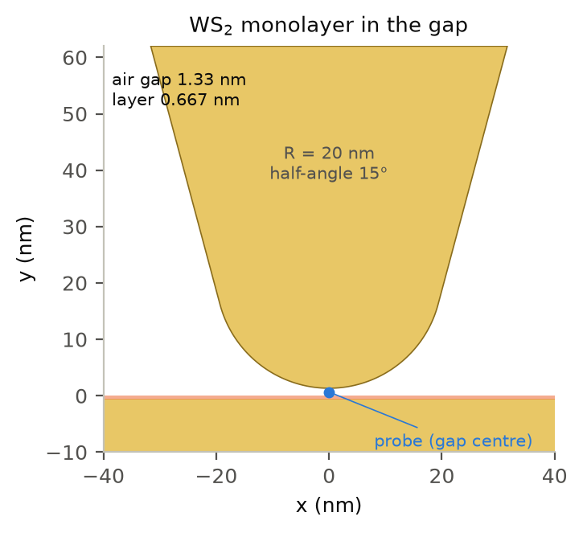
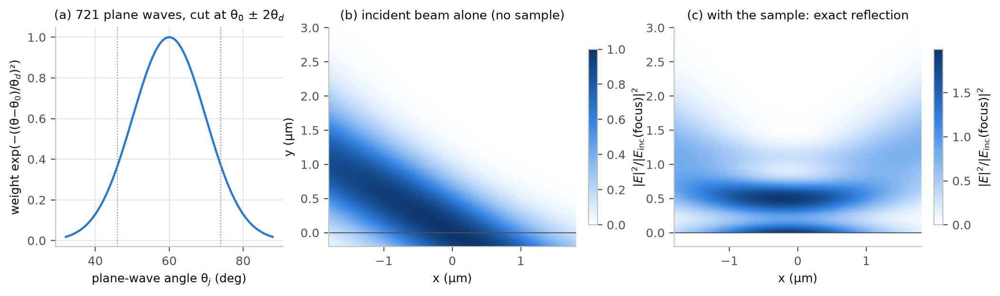
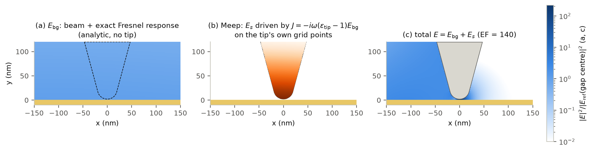
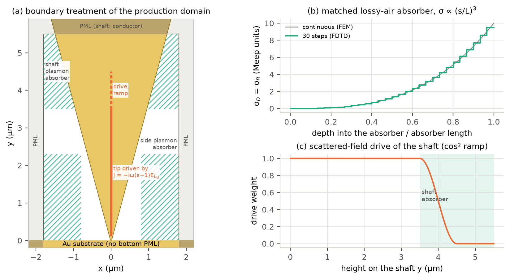

# Model and numerical method

This page describes what is simulated and how, and why the method looks the way it does.
How to change it for your own case is in [setting_up_your_simulation.md](setting_up_your_simulation.md);
what comes out is in [outputs.md](outputs.md).

## What is simulated

A 2D cross-section (the xy plane; nothing varies along z) of a metal tip held a few nm
above a sample and illuminated by a focused, p-polarized beam. The quantity of interest is
the near field in the gap between the apex and the sample, in particular the field
enhancement relative to the same sample without the tip. In 2D the tip is an infinitely
long ridge (a wedge), not a cone; [limitations.md](limitations.md) discusses what that
means for the numbers.

*(a) The computational domain of the reference results: an isolated, semi-infinite tip
(no periodic boundaries), PML on every side that needs one, lossy-air absorbers for the
surface plasmons of the shaft and of a metal substrate, and the part of the tip that is
driven by the beam. (b) The analytic tip-free field at 633 nm over gold. It drives the tip
and is the reference of the enhancement factor. (c) Apex and gap.*

## Coordinates and units

* y = 0 is the top surface of the sample (the surface the tip faces); the sample fills
  y < 0. The tip axis is x = 0 and the lowest point of the apex is at y = `gap_nm`.
* The beam comes from the upper left (x < 0, y > 0); its incidence angle is measured from
  the surface normal. p polarization: E = (Ex, Ey) in the plane, Hz out of plane.
* Tip, gap, layer thicknesses and wavelengths are given in nm; sizes of the computational
  domain in µm, which is also Meep's length unit (frequency f = 1/λ in 1/µm, c = 1).

## Geometry

**Tip.** A circle of radius R (the apex) and a wedge with half opening angle α whose faces
are tangent to the circle. The shaft leaves the domain through the top boundary, so the tip
has no end and nothing reflects from one. Defaults: R = 20 nm, α = 15°, gold.

**Gap.** `gap_nm` is the air gap between the apex and the top of the sample. With a layer
on a metal substrate, the metal-to-metal distance is the gap plus the layer thickness.

**Sample.** A semi-infinite substrate plus any number of layers (films infinite in x),
listed from the substrate upward. Each region may be isotropic or uniaxial with the optic
axis along the layer normal (y), which is the natural description of a 2D material: its
in-plane permittivity acts on Ex, its out-of-plane permittivity on Ey.

*Apex above a WS2 monolayer on gold: 0.65 nm snapped to one 0.667 nm cell at 1.5 pixels/nm,
1.333 nm of air, 2 nm between the two gold surfaces.*

## Materials

Every material is a passive pole model in Meep's convention,

    ε(f) = ε∞ + Σ_Lorentz σ f0² / (f0² − f² − i f γ) + Σ_Drude σ f0² / (−f² − i f γ),

with f, f0 and γ in 1/µm and time dependence exp(−i2πft). These are exactly Meep's
`LorentzianSusceptibility` and `DrudeSusceptibility`, so one object gives both the medium
that Meep simulates and the permittivity that the analytic reference field uses. With all
σ, γ ≥ 0 the model is passive (Im ε ≥ 0 at every frequency) and causal by construction;
`Pole` rejects anything else.

| material | model | source |
|---|---|---|
| Au | Lorentz–Drude fit, valid 248–6199 nm (identical to `meep.materials.Au`) | A. D. Rakić et al., Appl. Opt. 37, 5271 (1998), doi:10.1364/AO.37.005271 |
| SiO2 | n = 1.45, non-dispersive | — |
| WS2 monolayer, in plane | 7-pole Lorentz fit of monolayer ellipsometry data, valid 480–900 nm (relative RMS error of ε 2.3 %, max 5.0 %) | data: G. A. Ermolaev et al., J. Vac. Sci. Technol. B 38, 014002 (2020), doi:10.1116/1.5122683 |
| WS2, out of plane | 1-pole Lorentz fit of the bulk extraordinary index (width fixed at 0.02 µm⁻¹; Im ε < 0.01 in the window) | data: B. Munkhbat et al., ACS Photonics 9, 2398 (2022), doi:10.1021/acsphotonics.2c00433 |

No broadband out-of-plane data of a monolayer exist, so the bulk extraordinary index is the
proxy; the out-of-plane response of TMDs is weak and has no excitons. The gap field is
mostly normal to the layer, which is why the anisotropy matters: an isotropic model with
the excitonic in-plane permittivity on all axes would overstate how the excitons damp the
gap mode. Every WS2 pole has a width of at least 0.02 µm⁻¹, because a lossless pole rings
indefinitely in a pulsed run. Like any Lorentz fit of a band-edge material, the in-plane
fit overestimates the weak absorption below the A exciton (Im ε = 0.36 vs 0.19 at 700 nm,
0.13 vs 0.03 at 850 nm); it acts on the small in-plane component of the gap field. Both
tables are CC0 data of the refractiveindex.info database (`materials/nk/`), and
`materials/fit_ws2_lorentz.py` re-creates the packaged fits.

## Illumination: an exact focused beam at every wavelength

*(a) Angular spectrum of the default beam (60° ± 14°, 1/e² of the intensity at the dotted
lines). (b) The incident beam alone. (c) The tip-free field above gold: incident plus
reflected beam, |E|² normalized to the incident beam at its focus.*

The incident field is a 2D Gaussian beam written as a superposition of plane waves with
angles θj around θ0 and weights exp(−((θj − θ0)/θd)²), cut at θ0 ± 2θd (721 waves by
default), all in phase at the focus, the point of the sample surface below the apex. θd is
the divergence half-angle (1/e² of the intensity); the waist is w0 ≈ λ/(π θd), 1.3 λ for
14°. Each plane wave is reflected and transmitted by the layered sample with exact TM
transfer conditions (continuity of Hz and Ex at every interface; reflection coefficients
built recursively from the substrate up, which is stable for lossy or thick layers). The
result, E_bg, is an exact solution of Maxwell's equations for the sample without the tip.
It is synthesized separately for every wavelength, so the angles are exact at every point
of a spectrum.

A Gaussian angular spectrum makes the beam intensity fall off as a Gaussian away from its
axis, so the length of the semi-infinite shaft that the beam illuminates is well defined.
A cos² apodization (60° ± 25°) was tried first: its spectrum has a zero of finite order at
the aperture edge, which leaves power-law tails (|E_bg|² on the shaft 3 µm above the apex
was 4 × 10⁻³ of its gap value at 900 nm, still 9 × 10⁻⁴ at 4 µm), and the enhancement then
depended on where the drive of the shaft was cut (+10 % at 900 nm when the cut moved up by
0.5 µm).

## Scattered-field formulation

*E = E_bg + E_s. (a) The analytic tip-free field. (b) Meep computes only the field
scattered by the tip, driven by the polarization current that E_bg induces in the tip (here
|E_bg| times the drive weight on the tip's grid points). (c) The total field of the finished
run (Au, 633 nm, 1 nm cells); both maps are normalized to the tip-free intensity at the gap
centre.*

Write the total field as E = E_bg + E_s. Subtracting the equations of the tip-free sample
from those of the full structure gives

    ∇ × H_s = −iω ε E_s + J,     J = −iω (ε_tip(ω) − 1) E_bg   inside the tip,

so the scattered field is driven only by the polarization current of the tip itself, which
sits in air (ε = 1) in the tip-free problem. Meep propagates E_s in the full structure (tip,
sample and boundary layers); J is set on every Ex and Ey Yee point inside the staircased
tip, with exactly the inside test that Meep uses for the geometry (`sources.py`; each
amplitude array is padded with one row and column of zeros so that Meep's interpolation of
`amp_data` puts every value on its own Yee point). The DFT of E_s at the run frequency is
divided by the Fourier amplitude of the source pulse (times 1/2, because Meep's fields are
real), and E = E_bg + E_s is formed on the monitor grids. The tip-free reference has J = 0,
so its field is exactly E_bg and needs no simulation.

Why not a source in air: any localized source near a metal surface launches surface plasmon
polaritons (SPPs) through its near field, and a focused beam in free space cannot do that on
a flat surface. In the first implementation a Huygens line source 0.2 µm above gold at 633
nm produced an SPP (identified by its in-plane wavenumber ≈ 1.05 k0) whose amplitude at the
gap was ~40 % of the reflected field, and a total-field/scattered-field plane crossing the
substrate produced a comparable artefact. With the scattered-field formulation the only
sources are inside the tip.

The formulation is checked against the exact Mie solution of a gold cylinder driven the same
way, with no fitted constant ([validation.md](validation.md)).

## Enhancement factor

    EF(λ) = |E_tip(r)|² / |E_ref(r)|²,

with r the probe point (default: the gap centre, on the axis halfway between the sample
surface and the apex) and E_ref = E_bg the tip-free field at the same point. The gap
average, the |E|⁴ estimate, the field inside the top layer and the intensity relative to the
incident beam are defined in [outputs.md](outputs.md).

## Discretization

* Meep's uniform Yee grid without sub-pixel averaging (Meep's smoothing does not cover the
  dispersive part of a material, so it is switched off and every interface is staircased
  the same way). The sample surface, every layer interface and the lowest point of the apex
  lie on grid lines: the gap is a whole number of cells and each layer is snapped to whole
  cells (an error is raised if that changes its thickness by more than 5 %; the snapped
  value is used everywhere, including the analytic field and the FEM reference). The
  curved apex and the wedge faces are staircased differently at each resolution.
* The cell has an even number of pixels along x and y (one cell is added to the substrate
  if needed): for an odd count Meep centres the grid half a cell off, which would misplace
  the source points relative to the staircased tip.
* Production resolution: 1 pixel/nm (2 cells across the default 2 nm gap). The error this
  causes is measured against the FEM reference of the same model and by resolution series
  in the small domain ([validation.md](validation.md)).
* One simulation per wavelength: a broadband Gaussian pulse centred on the wavelength, of
  which only the DFT at the centre frequency is used. The structure is built once per
  geometry; for every wavelength the fields are reset and the sources rebuilt. A run stops
  when the DFT fields change by less than 10⁻⁴ (relative) after the scattered light has
  crossed the free region once, and fails if that has not happened 80 µm/c after the source.

## Boundaries and absorbers

*(a) Boundary treatment of the production domain. (b) Conductivity of the matched lossy-air
absorbers (cubic profile, 30 steps in the FDTD, continuous in the FEM). (c) Weight of the
scattered-field drive along the shaft.*

The tip is isolated: no periodic boundaries. Five things need care.

**Dispersive metal in the PML.** Meep's PML is unstable where a Drude metal crosses it (Meep
FAQ, "Why are the fields blowing up in my simulation?"); this was observed here in both FP32
(gpmeep) and FP64 (upstream Meep) runs. Inside the PML the shaft and a metallic substrate
are therefore replaced by a non-dispersive conductor (ε = 1, Meep `D_conductivity` = 20, i.e.
ε = 1 + 20i/ω). Meep's conductivity acts on D, so it multiplies the whole permittivity; a
conductive absorber placed on gold (Re ε < 0) adds gain instead of loss, which rules it out
as a PML substitute for the metal.

**Dispersive layers.** A run with the anisotropic Lorentz WS2 layer crossing Meep's PML
diverged, so dispersive layers stop at the side PML; non-dispersive layers continue into it.
On a metal substrate the fields at the end of the layer have already passed the side
absorbers.

**Surface plasmons.** In 2D the plasmons launched along the shaft and along a metal surface
propagate for many micrometres without spreading, and the conductor step at the PML reflects
them back to the gap. Most of their field is in the air (|ε_Au| ≫ 1), so making the gold
lossier barely damps them (a first version did this and transmitted 83–98 % of the plasmon
field). Instead the air itself is made lossy: around the shaft from y = 3.5 µm (measured on
the faces) to the top of the free region, and above a metal substrate for
0.8 µm ≤ |x| ≤ 1.8 µm, y ≤ 2.3 µm. The absorber is impedance matched (equal electric and
magnetic conductivity, ε = μ = 1 + iσ/ω), its σ grows as the cube of the depth to 10 (Meep
units) over 2 µm (shaft) and 1 µm (sides) in 30 steps, and the gold is unchanged. Like a PML,
the absorbers act on the scattered field only (the analytic incident field is not modified).

They must be long and gentle: a matched medium is reflectionless only at normal incidence,
and an abrupt one reflects plasmons and oblique radiation. This was found, and the design
chosen, with the FEM reference, which solves the same problem in seconds: a 1 µm absorber
with σ rising quadratically to 40 gave enhancements up to 6 % away from the final design and
changed them by 3–4 % when it was moved by 0.5 µm (seen in both FEM and FDTD). Without
absorbers, even a frequency-domain PML with the gold continuing into it reflects the shaft
plasmons (1.4–4.6 % change when the PML is moved by 0.5 µm): a PML is not reflectionless for
a structure that varies along the PML direction, here the widening wedge (A. F. Oskooi et
al., Opt. Express 16, 11376 (2008), doi:10.1364/OE.16.011376). The final design is
insensitive to its strength (σ 7–15: < 0.5 %) and position (moved by 0.5 µm: < 1 %), and
gives the same result whether the gold continues into the PML or is replaced by the
conductor (≤ 0.04 %).

**Illumination of the shaft.** In the scattered-field formulation the source sits on every
tip grid point that the beam reaches, so the beam itself defines how much of the shaft is
illuminated. The drive has full weight up to y = 3.5 µm and falls to zero with a cos² profile
at 4.5 µm, inside the shaft absorber. At y = 3.5 µm |E_bg|² on the shaft faces is at most
10⁻³ of its value at the gap centre (500–900 nm, Au and SiO2; every run records this number
as `shaft_illumination_at_ramp`). A first version ramped the drive down between 1.5 and 2.5
µm, where the beam is still strong; the enhancement then changed by up to 22 % when the ramp
moved by 0.5 µm.

**Below the substrate.** An opaque metal substrate ends at the bottom of the cell without a
PML (0.2 µm of gold, many skin depths; a check requires the normal-incidence round trip to
attenuate the field below 10⁻²); a dielectric substrate continues into a bottom PML.

Which treatment applies is decided from the materials at the simulated wavelengths ("metal":
Re ε < 0):

| element | in the free region | at the boundary |
|---|---|---|
| tip shaft | the tip material | top PML; replaced by the conductor if dispersive |
| metallic substrate | the substrate material | conductor in the side PML; no bottom PML; side absorbers |
| non-metallic substrate | the substrate material | continues into the side and bottom PML |
| dispersive layer | the layer material | stops at the side PML |
| non-dispersive layer | the layer material | continues into the side PML |

Side absorbers are on if the substrate or any layer is metallic; every choice can be forced in
`Numerics`.

## Performance

In single-process runs (the GPU, or one CPU core) the cell is split into bands
(`meep.BinaryPartition`) so that the polarization fields of the dispersive materials are
stored and updated only in the chunks that contain the tip or the sample. This roughly halves
the time per step on the GPU. MPI runs use Meep's own chunk layout.

## Frequency-domain reference

`ters2d.fem.solve(model, wavelength)` solves the same problem for Hz in the frequency domain
with NGSolve: the same tip, sample, beam, drive ramp, absorbers (continuous instead of
stepped) and conductor-in-PML, but curved high-order elements refined in the gap and the
layers, and a complex coordinate-stretching PML. A case takes 10–60 s on 16 cores. Because it
has no staircasing it gives the converged answer of the model; because it shares every
modelling choice with the FDTD it does not test those choices ([limitations.md](limitations.md)).
