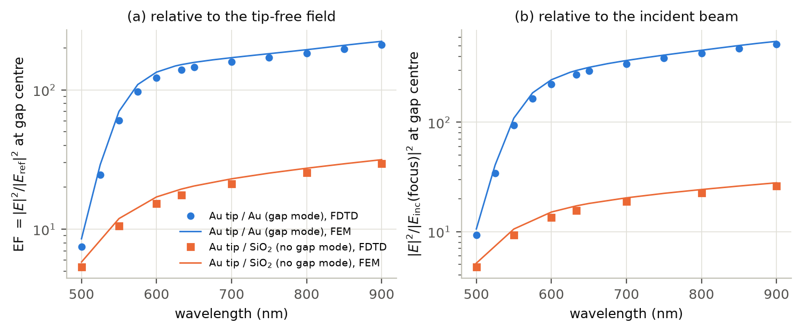
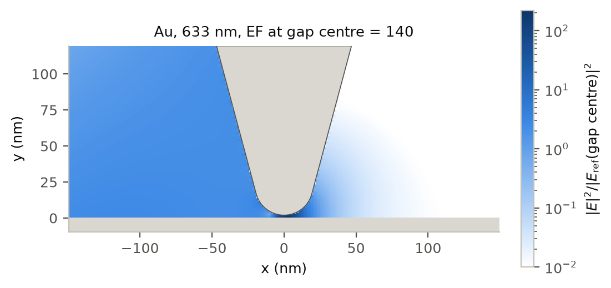
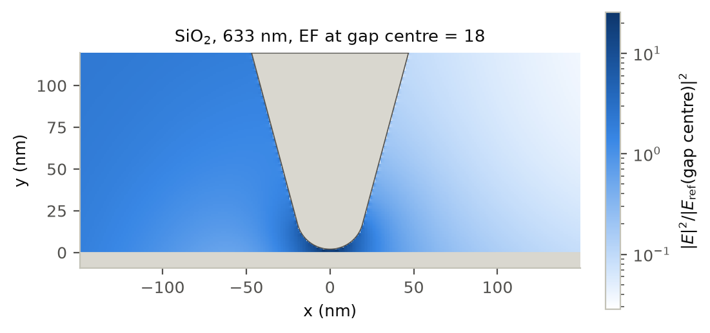
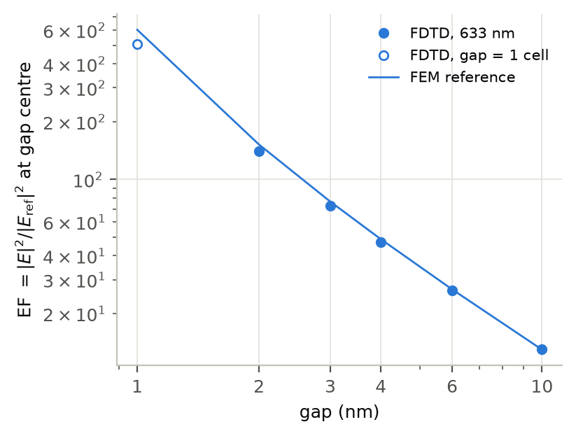
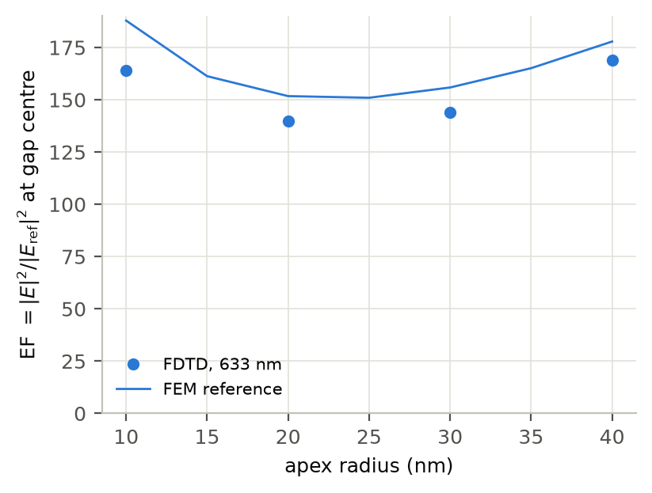
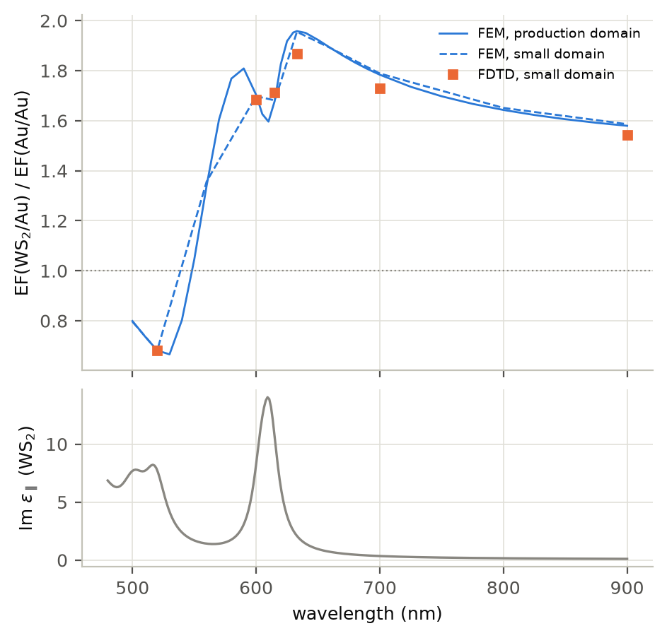

# Results

These are the results computed with this code for the default gap-mode geometry and its
variations. Unless stated otherwise: Au tip with apex radius R = 20 nm and half-angle 15°,
2 nm gap, 60° p-polarized Gaussian beam (divergence 14°), production domain at 1 pixel/nm,
gpmeep on one GPU. In the figures, markers are FDTD and lines are the frequency-domain (FEM)
solution of exactly the same model, which has no staircasing. The numbers in the text are
FEM values, the accurate numbers of this 2D model; the FDTD values are in the tables and are
5–16 % lower (−8 % at 633 nm; see [validation.md](validation.md)). The tables, scripts and
figures are listed at the end.

## Gap mode vs no gap mode

*(a) EF = |E|²/|E_ref|² at the gap centre, E_ref the tip-free field at the same point. (b)
|E|² at the gap centre relative to the incident beam at its focus (without sample).*

With a gold substrate the field in the gap is 152 times the tip-free field at 633 nm (223 at
900 nm); above SiO2 it is 19 times (32). The image charges in the gold mirror turn the apex
field into a gap plasmon. Relative to the incident beam the contrast is larger, 297 vs 17 at
633 nm, because on gold the reflected beam already doubles the tip-free intensity at the gap
(1.96 times the incident intensity at the focus), whereas on SiO2 at 60°, close to the
Brewster angle, it adds little (0.89 times).

For R = 20 nm and a 2 nm gap this 2D model has no gap-plasmon resonance between 500 and 900
nm: the enhancement rises towards the red, and below ~600 nm it is limited by the interband
absorption of gold (EF 8.5 at 500 nm). The |E|⁴ Raman estimate is EF² ≈ 2.3 × 10⁴ at 633 nm
(column `EF4_probe`; FDTD gap average `EF4_gap` 2.0 × 10⁴).

## Near field around the apex

*|E|² at 633 nm normalized by the tip-free intensity at the gap centre (FDTD, 1 nm cells;
top: Au substrate, bottom: SiO2; the beam comes from the upper left).*

Above gold the field is concentrated in the gap below the apex. Above SiO2 the apex gives a
weaker (EF 18 in this FDTD map) and less confined lightning-rod enhancement. The dark region
to the right of the tip is the geometric shadow of the semi-infinite 2D wedge, which light
cannot pass around; a 3D cone does not cast such a shadow.

## Gap and apex radius at 633 nm

 

EF falls from 602 (1 nm gap) to 152 (2 nm), 49 (4 nm) and 13 (10 nm): about g⁻² below 2 nm
and g⁻¹·⁵ between 2 and 10 nm. The 1 nm point is a single FDTD cell (open marker, −16 %
against the FEM); local optics also becomes questionable at that distance
([limitations.md](limitations.md)).

The radius dependence is not monotonic: EF = 188, 161, 152, 151, 156, 165 and 178 for
R = 10, 15, 20, 25, 30, 35 and 40 nm, with a minimum near 25 nm. It is a property of the
apex and the gap, not of the beam or the shaft: with the shaft plasmons absorbed 0.3 µm
above the apex the values change by only −2.6 %, and with a narrower beam (divergence 10°
instead of 14°) by −3 %. It is specific to the 2D wedge: an isolated gold cylinder of the same
radius above gold gives a monotonic trend (EF 24, 101 and 309 for R = 10, 20 and 40 nm,
`nanogap_fem.csv`).

## WS2 monolayer in the gap

*Ratio of the gap-centre EF with and without a WS2 monolayer on the gold (same tip, same 2 nm
distance between the gold surfaces). Lower panel: absorption of the in-plane WS2 model.*

The monolayer (0.667 nm on the grid; out-of-plane permittivity ε⊥ ≈ 6.6 at 633 nm) fills a
third of the 2 nm gap. The normal field in the remaining 1.33 nm of air is then larger, and
EF at the centre of the air gap rises by a factor 1.6–2.0 away from the excitons (1.96 at
633 nm). At the excitons the absorption of the layer damps the gap mode: the ratio falls to
0.67 at the B exciton (530 nm) and dips to 1.60 at the A exciton (610 nm), between 1.81 at
590 nm and 1.96 at 633 nm. The field inside the layer, which drives the Raman scattering of
WS2 itself, is weaker: |E|²/|E_ref|² averaged over the layer is 36 at 610 nm and 59 at 633 nm
(column `EF_layer` of `fem_tip_reference.csv`).

The FDTD ratios are computed in the small domain at 1.5 pixels/nm (the layer is one cell).
The FEM gives the same ratio in the small domain and in the production domain (within 1.3 %;
0.5 % except at 560 nm), and the FDTD agrees with the FEM within −4.4 % to +1.8 % at the
sampled wavelengths.

## Uncertainty

For the results as a model of a 2D tip, the numerical uncertainty is small compared with the
modelling choices:

* FEM values (quoted in the text): < 1 % (convergence and boundary checks).
* FDTD values at 1 pixel/nm (markers, tables): biased low by the amounts in
  [validation.md](validation.md) (−8 % at 633 nm for the default case); boundary effects
  ≤ 1 %; FP32 rounding negligible (2.7 × 10⁻⁶).
* Model parameters that are choices, not errors: the beam divergence (10° instead of 14°: −3 %
  at 633 nm), the illuminated length of the shaft (shaft plasmons absorbed 0.3 µm above the
  apex: −2.6 %), the WS2 thickness and out-of-plane permittivity, the bulk gold permittivity.
* The 2D geometry itself is the dominant difference from a real tip and is not quantified
  here ([limitations.md](limitations.md)).

## Data and scripts

| figure | table(s) in `figures/data/` | produced by |
|---|---|---|
| `spectra.png` | `spectrum_Au_fdtd.csv`, `spectrum_SiO2_fdtd.csv`, `fem_tip_reference.csv` (group `spectrum`) | `reproduce/spectra.py`, `validation/fem_tip_reference.py` |
| `fieldmap_Au_633nm.png`, `fieldmap_SiO2_633nm.png` | `fieldmap_Au_633nm.npz`, `fieldmap_SiO2_633nm.npz` | `reproduce/field_maps.py` (from the spectrum runs) |
| `gap_sweep.png` | `gap_sweep_fdtd.csv`, FEM group `gap` | `reproduce/gap_sweep.py` |
| `radius_sweep.png` | `radius_sweep_fdtd.csv`, FEM groups `radius`, `radius_div10`, `radius_local` | `reproduce/radius_sweep.py` |
| `ws2_on_au.png` | `ws2_on_au_fdtd.csv`, FEM groups `ws2`, `ws2_small` | `reproduce/ws2_on_au.py` |
| `ws2_lorentz_fit.png` | `ws2_lorentz_fit.csv` | `materials/fit_ws2_lorentz.py` |
| validation figures | see [validation.md](validation.md) | `validation/*.py` |
| — | `run_times.csv` (time steps, wall times, cells and backend of every run) | the run metadata |

`reproduce/make_figures.py` renders every figure from these tables (no Meep needed);
`reproduce/make_schematics.py` the schematics of [model.md](model.md). The FDTD tables were
computed with the code before the restructuring of this repository; the regression check in
[validation.md](validation.md) shows that the current code reproduces them.
