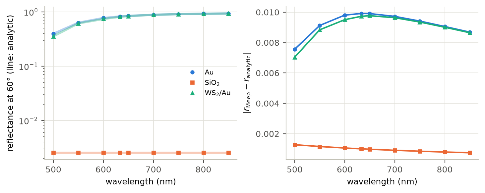
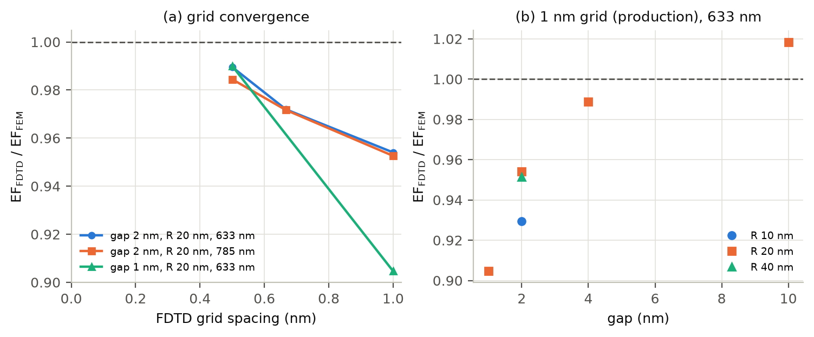
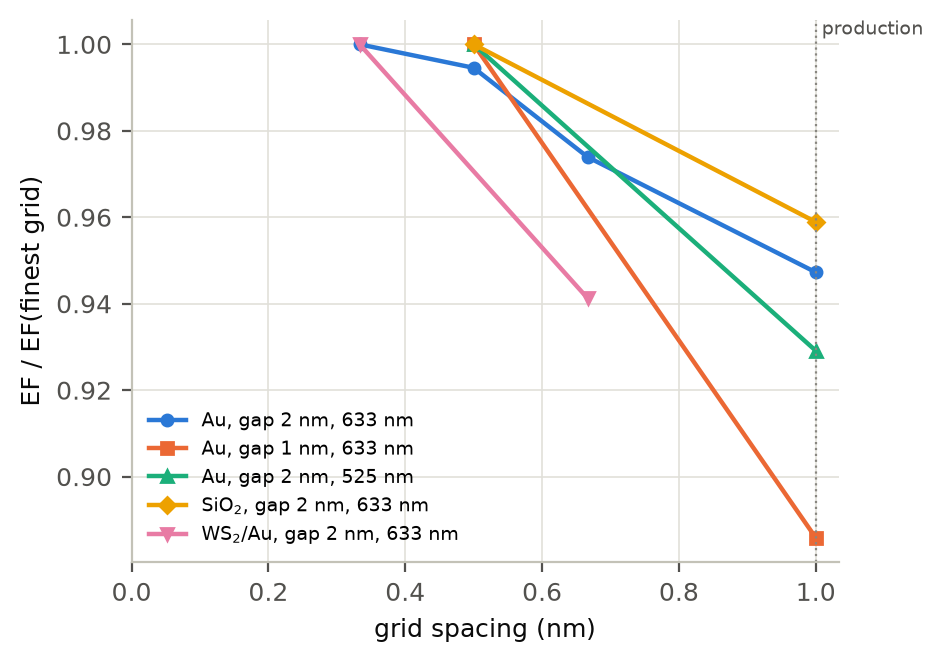

# Validation

Every check has a script in `validation/` and its data in `docs/figures/data/`. The checks go
from the parts (the reference field, the source, the materials) to the whole model, and end
with the numerical settings.

| check (script) | what is compared | result |
|---|---|---|
| Tip-free reference vs Meep (`fresnel_check.py`) | specular reflection of Au, SiO2 and WS2/Au computed by Meep (Bloch-periodic cell, no tip, 1.5 px/nm) vs the transfer-matrix coefficient used for E_bg; 500–850 nm at 60°, 633 nm at 40–70° | \|Δr\| ≤ 0.011, \|ΔR\|/R ≤ 0.6 %, phase ≤ 0.7° (Au, WS2/Au) / 1.5° (SiO2) |
| Scattered-field formulation vs Mie (`mie_check.py`) | Au cylinder (R = 20 nm) in free space, driven exactly like the tip, vs the exact 2D Mie series for the same beam; no fitted constants | at 1–1.5 px/nm: ≥ 4 cells from the surface \|E\| rel. L2 error 0.4–0.9 %, mean \|E\|² within 0.4 %; 1–3 nm from the surface (where gap probes sit) rel. L2 4–7 % (staircase), mean \|E\|² within 1.3 % |
| Nanogap FDTD vs FEM (`nanogap_fdtd.py`, `nanogap_fem.py`) | Au cylinder 1–10 nm above Au, R = 10–40 nm; FDTD at 1–2 px/nm vs curved-element FEM converged to 0.1 % | 2 nm gap, R = 20 nm: −4.6 / −2.8 / −1.0 % at 1 / 1.5 / 2 px/nm (633 nm), −4.7 / −2.8 / −1.6 % (785 nm); 1 nm gap: −9.5 % (1 px/nm), −1.0 % (2 px/nm); at 1 px/nm: 4 nm −1.1 %, 10 nm +1.8 %, R = 10 nm −7.1 %, R = 40 nm −4.9 % |
| Full model FDTD vs FEM (`fem_tip_reference.py`) | the same tip model at every wavelength, gap and radius of the results, production domain, FDTD at 1 px/nm | Au, 2 nm: −5.3 % (900 nm) to −15.9 % (525 nm), −7.7 % at 633 nm; SiO2: −6.4 % to −11.5 %; gap 1 / 2 / 3 / 4 / 6 / 10 nm: −15.9 / −7.7 / −4.8 / −2.9 / −0.8 / +0.8 %; R = 10 / 20 / 30 / 40 nm: −12.3 / −7.7 / −7.4 / −4.9 % |
| Resolution in the production domain (`production_checks.py`) | Au/Au, 633 nm, FDTD at 1 and 1.5 px/nm (60 million cells) vs FEM | EF 139.7 → 143.8 (−7.7 % → −5.0 % against the FEM 151.3); extrapolated to zero cell size: +0.5 % (first order) or −2.8 % (second order) |
| Resolution in the small domain (`resolution_series.py`) | FDTD at 1–3 px/nm vs the FEM of the same (small) domain | Au, 2 nm, 633 nm: EF = 352.6 / 362.5 / 370.2 / 372.2 at 1 / 1.5 / 2 / 3 px/nm, FEM 380.5: −7.3 / −4.7 / −2.7 / −2.2 %; from 1 to 2 px/nm: +12.9 % (1 nm gap), +7.6 % (525 nm), +4.3 % (SiO2) |
| WS2 layer (`reproduce/ws2_on_au.py`) | FDTD ratio EF(WS2/Au)/EF(Au/Au) at 1.5 px/nm (layer = 1 cell), small domain, vs FEM | 520–900 nm: −4.8 % to +1.4 %; at 633 nm 1.869 (1.5 px/nm) and 1.934 (3 px/nm) vs FEM 1.964 |
| Layer effect, small vs production domain (`layer_transfer_fem.py`, FEM) | EF(WS2 on substrate)/EF(substrate) at a 2 nm apex-substrate distance, 633 nm | Au +0.21 %, Ag +0.39 %, SiO2 +0.61 % (and Au over 500–900 nm: ≤ 1.3 %, groups `ws2`/`ws2_small`); FDTD of the same pairs in the small domain at 1.5 px/nm (example 05, `example05_layer_effect.csv`): ×1.869 / 1.818 / 1.670, i.e. 4.8 / 3.3 / 5.4 % below the FEM, and stable on all three substrates |
| Domain check at 2 nm cells (`examples/08_convergence_check.py`, `coarse_checks.csv`) | the same variants plus the drive ramp alone +0.5 µm, production domain at 2 nm cells; and the small domain moved by 0.1 µm | production domain: ≤ 0.31 %; small domain: −17 % (it is not a domain for absolute values) |
| Domain and boundaries (`domain_check.py`) | production domain at 1 px/nm, one variant at a time: free region, absorbers and drive ramp moved up 0.5 µm (side absorbers out 0.2 µm, up 0.3 µm); absorbers 1.5× stronger; PML 2× thicker | ≤ 1.0 % (Au at 633 and 900 nm, SiO2 at 900 nm) |
| Stop rule (`production_checks.py`) | Au/Au, 633 nm: minimum run time 14 µm/c after the source (shaft echoes included) instead of one transit | EF 139.6657 vs 139.6640 (+1.2 × 10⁻⁵; 35 476 instead of 20 272 steps) |
| FEM reference itself (`fem_tip_reference.py`, `check_*`) | polynomial order 4 → 5; finer mesh; absorber σ 7–15; free region, absorbers and ramp moved; drive ramp moved by ±0.5 µm; gold continued into the PML instead of the conductor | ≤ 0.04 %, < 0.01 %, ≤ 0.47 %, ≤ 0.99 %, ≤ 1.02 %, ≤ 0.04 % (Au 525–900 nm, SiO2 900 nm, WS2/Au 633 nm) |
| FP32 vs FP64 (`fp32_vs_fp64.py`) | gpmeep (FP32, one GPU) vs upstream Meep 1.34 (FP64, CPU) | production Au/Au, 633 nm (20 272 steps, 32 MPI processes): 139.66402 vs 139.66364, 2.7 × 10⁻⁶; small-domain WS2/Au, 1.5 px/nm (66 500 steps, 4 MPI processes): 9.4 × 10⁻⁵ (677.554 vs 677.618) |
| This code vs the reference runs (`regression_check.py`) | production Au (3 wavelengths) and SiO2, small-domain Au and WS2/Au, re-run with gpmeep | ≤ 2 × 10⁻⁶; see below |

*Tip-free reflectance at 60°: Meep (markers) and the analytic coefficient (lines), and the
error of the complex reflection coefficient.*

*Cylinder nanogap: FDTD EF relative to the converged FEM value. (a) Grid convergence. (b) At
the production grid of 1 nm.*

*Resolution series of the tip model in the small domain, relative to the finest grid of each
series (for WS2/Au the gap is the apex-to-gold distance).*

## What the numbers say

**The FDTD deviation from the FEM is discretization.** It grows as the gap has fewer cells
(from +0.8 % at 10 cells to −15.9 % at one), for smaller apex radii and at shorter
wavelengths, where |ε_Au| is smaller and the staircase of the apex and of the wedge faces
matters more; it does not change when the boundaries are moved. For the cylinder nanogap the
FDTD converges to the FEM value (−4.6, −2.8 and −1.0 % at 1, 1.5 and 2 px/nm). For the tip it
does too, in both domains: in the production domain refining from 1 to 1.5 px/nm moves the
FDTD from −7.7 % to −5.0 % relative to the FEM; in the small domain the series approaches the
FEM of that domain from below (−7.3 / −4.7 / −2.7 / −2.2 %).

**Small and production domain show the same discretization error.** At 1 px/nm the
small-domain FDTD is −7.3 % below the FEM of that domain, the production FDTD −7.7 % below its
FEM, and both converge to their FEM from below when refined (−7.3 / −4.7 / −2.7 / −2.2 % at 1
/ 1.5 / 2 / 3 px/nm in the small domain; −7.7 % → −5.0 % at 1 → 1.5 px/nm in production, +0.5
% after a first-order extrapolation in the cell size, −2.8 % after a second-order one). The change between the two finest grids
of a series (+0.5 % from 2 to 3 px/nm) understates the remaining error (−2.2 %); an
extrapolation in the cell size (−1.1 %) or the FEM gives it.

**The FEM values are the accurate numbers of this 2D model.** The FEM solves the continuous
problem, is converged to < 0.1 % in order and mesh, and moves by ≤ 1.0 % with its boundaries
in the cases checked. The FDTD at 1 pixel/nm reproduces every trend and is low by the amounts
above. [results.md](results.md) therefore quotes FEM values; the FDTD values are in the CSV
files.

**FP32 is not a limitation here.** gpmeep (FP32) and upstream Meep (FP64) agree to 2.7 × 10⁻⁶
for the production case and to 9.4 × 10⁻⁵ (677.554 vs 677.618) for a 66 500-step WS2 run.

## Regression check of this code

The code of this repository was restructured from the one that produced the reference FDTD
runs (same physics, new API, N-layer transfer matrix, sample surface as the coordinate origin,
domain heights measured from the substrate surface as before).
`validation/regression_check.py` re-runs a subset with gpmeep on one GPU (~1 GPU-hour) and
compares it with the committed tables (`figures/data/regression_check.csv`):

| case | EF now | EF reference | relative difference |
|---|---|---|---|
| small Au, 1.5 px/nm, 633 nm | 362.517791 | 362.517791 | 0 |
| small WS2/Au, 1.5 px/nm, 633 nm | 677.554390 | 677.553052 | +2.0 × 10⁻⁶ |
| ratio WS2/Au to Au/Au, 633 nm | 1.869024 | 1.869020 | +2.0 × 10⁻⁶ |
| production Au, 633 nm | 139.664027 | 139.664016 | +8.3 × 10⁻⁸ |
| production Au, 525 nm | 24.497487 | 24.497508 | −8.8 × 10⁻⁷ |
| production Au, 900 nm | 210.731236 | 210.731236 | −9.7 × 10⁻¹⁴ |
| production SiO2, 633 nm | 17.637640 | 17.637637 | +1.7 × 10⁻⁷ |

The runs take the same number of time steps as the reference runs (20 272 for the production
case at 633 nm), and the differences are at the level of FP32 rounding.
